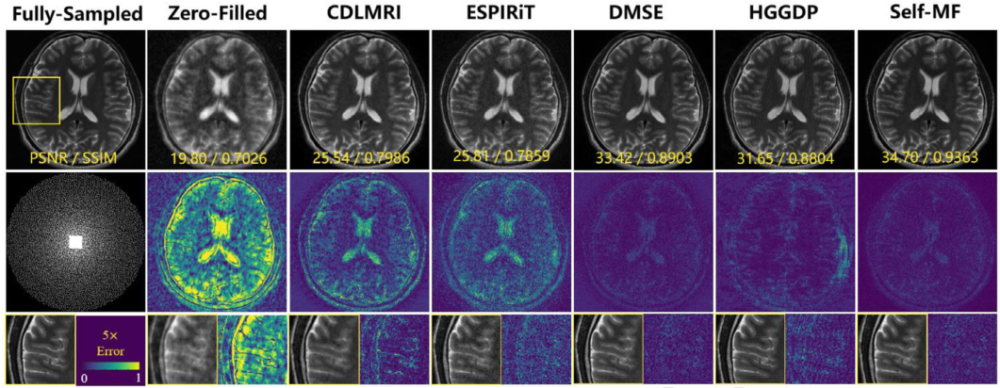
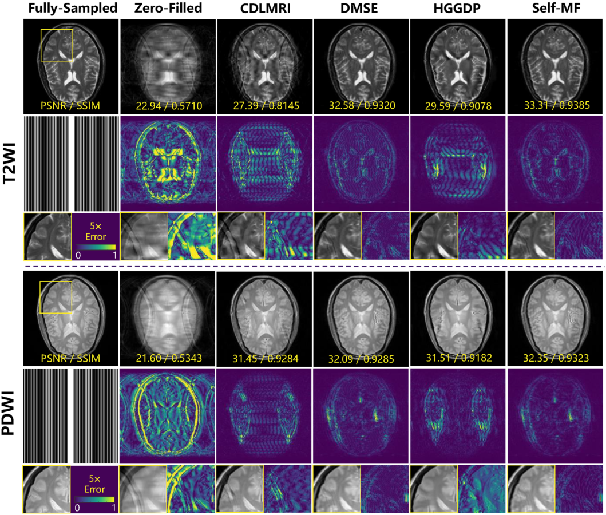
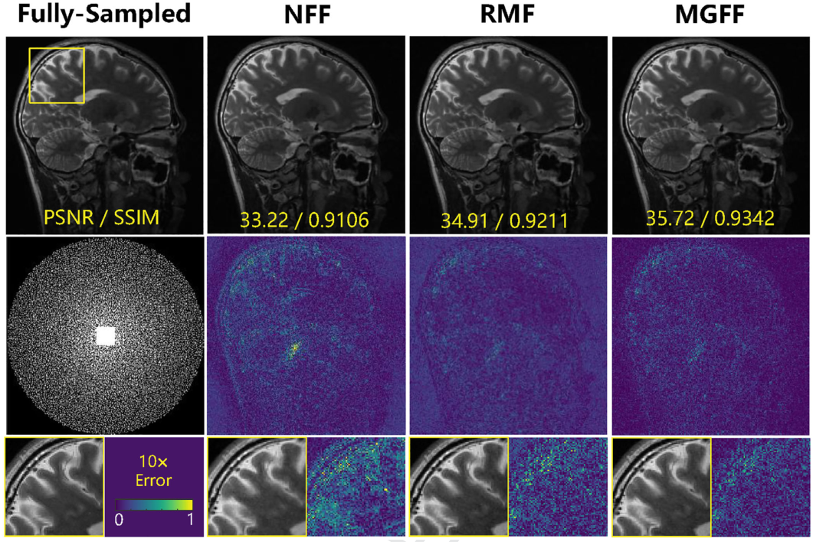

<div align="center">\n\n# Self-MF\n\n### Self-supervised Multi-contrast MRI Reconstruction via Mask-guided Frequency-domain Fusion\n\n**Zhibo Chen · Dong Wang · Yu Guan · Xiang Ji · Qiegen Liu**\n\n**Medical Physics, 2026**\n\n[](https://doi.org/10.1002/mp.70708)\n[](https://doi.org/10.1002/mp.70708)\n[](https://pytorch.org/)\n\n[**Paper**](https://doi.org/10.1002/mp.70708) &nbsp; · &nbsp; [**Method**](#method) &nbsp; · &nbsp; [**Experiments**](#experimental-results) &nbsp; · &nbsp; [**Code**](#code-and-data) &nbsp; · &nbsp; [**Citation**](#citation)\n\n</div>\n\n---\n\n## Overview\n\n**Self-MF** is a self-supervised, score-based framework for accelerated **multi-contrast magnetic resonance imaging (MC-MRI)**. Its central objective is to exploit anatomical redundancy across contrasts while learning from acquired **under-sampled target k-space**, without requiring fully sampled target-contrast training labels.\n\nThe framework integrates **contrast-aware measurement partitioning**, **mask-guided frequency-domain fusion (MGFF)**, and **conditional diffusion-based reconstruction**. An auxiliary contrast contributes structural guidance, while the target contrast supplies the data-fidelity constraints.\n\n<div align="center">\n\n<br><sub><b>Figure 1.</b> Mask-guided frequency-domain fusion: complementary frequency conditions derived from an auxiliary contrast.</sub>\n<br><sub><a href="figures/1.pdf">View figure PDF</a></sub>\n</div>\n\n## Highlights\n\n- **Self-supervised target learning:** acquired target k-space is divided into disjoint input and held-out subsets, reducing dependence on fully sampled target labels.\n- **Frequency-domain cross-contrast guidance:** complementary frequency masks organize reference-derived anatomical information into multiple conditioning channels.\n- **Physics-guided reconstruction:** conditional score-based sampling is combined with data consistency (DCL) and intensity calibration (ICL).\n\n## Method\n\n### 1. Contrast-aware self-supervision\n\nLet the acquired target sampling set be $\Omega$. The self-supervised training scheme constructs an input subset $\Omega_{\mathrm{in}}$ and a held-out supervision subset $\Omega_{\mathrm{sup}}$:\n\n$$\n\Omega = \Omega_{\mathrm{in}} \cup \Omega_{\mathrm{sup}},\n\quad \Omega_{\mathrm{in}} \cap \Omega_{\mathrm{sup}} = \varnothing.\n$$\n\nThe paper studies different input proportions and reports a favorable setting of **$\alpha = 0.4$**. The held-out measurements provide target-specific self-supervision, while a fully sampled reference contrast provides complementary structural information.\n\n<div align="center">\n\n<br><sub><b>Figure 2.</b> Self-supervised training from partially observed multi-contrast k-space.</sub>\n<br><sub><a href="figures/2.pdf">View figure PDF</a></sub>\n</div>\n\n### 2. Mask-guided frequency-domain conditioning\n\nComplementary frequency masks extract structural information from the auxiliary contrast and combine it with acquired target measurements to form conditional channels for the score network. The conditional representation provides cross-contrast guidance while retaining target-specific measurement information.\n\n### 3. Conditional score-based reconstruction\n\nSelf-MF uses a reverse-time diffusion process with predictor-corrector sampling. After each refinement, **data consistency (DCL)** constrains the reconstructed k-space using acquired target samples. The framework also incorporates **intensity calibration (ICL)** to reduce cross-contrast intensity inconsistencies.\n\n<div align="center">\n\n<br><sub><b>Figure 3.</b> Conditional score-based reconstruction with predictor-corrector updates, DCL and ICL.</sub>\n<br><sub><a href="figures/3.pdf">View figure PDF</a></sub>\n</div>\n\n## Experimental results\n\nThe study reports experiments on **IXI**, **fastMRI brain**, and **SIAT** multi-contrast MRI datasets with different undersampling patterns and acceleration factors. The values below are quoted from the published article (PSNR in dB; higher PSNR and SSIM are better).\n\n| Dataset | Reconstruction setting | Contrast | PSNR ↑ | SSIM ↑ |\n|:--|:--|:--:|--:|--:|\n| SIAT | 2D random, $R=4$ | T1WI | **35.16** | **0.8870** |\n| SIAT | 2D random, $R=4$ | T2WI | **33.46** | **0.9054** |\n| SIAT | 2D random, $R=4$ | PDWI | **35.31** | **0.9187** |\n| fastMRI brain | 2D random, $R=4$ | T2WI | **41.15** | **0.9637** |\n| fastMRI brain | 2D random, $R=8$ | T2WI | **35.02** | **0.8814** |\n\n### Reconstruction comparisons\n\n<details open>\n<summary><b>Figure 4 · SIAT: T1WI, T2WI and PDWI</b></summary>\n<br>\n<div align="center"><a href="figures/4.pdf"></a><br><sub>Click the figure to open the PDF.</sub></div>\n</details>\n\n<details>\n<summary><b>Figure 5 · fastMRI: T2-weighted brain reconstruction</b></summary>\n<br>\n<div align="center"><a href="figures/5.pdf"></a></div>\n</details>\n\n<details>\n<summary><b>Figure 6 · IXI: T2WI and PDWI reconstruction</b></summary>\n<br>\n<div align="center"><a href="figures/6.pdf"></a></div>\n</details>\n\n### Ablation study\n\nThe frequency-fusion ablation compares **NFF** (no frequency fusion), **RMF** (random mask fusion), and **MGFF** (mask-guided frequency fusion). The paper also evaluates input/held-out partition ratios and compares self-supervised and fully supervised training.\n\n<details open>\n<summary><b>Figure 7 · Frequency-domain fusion ablation</b></summary>\n<br>\n<div align="center"><a href="figures/7.pdf"></a></div>\n</details>\n\n## Code and data\n\n### Repository layout\n\n```text\nSelf-MF/\n├── selfmf/\n│   ├── main.py                  # Training entry point\n│   ├── reconstruct.py           # Reconstruction driver\n│   ├── sampling_conditional.py  # Conditional sampler and data consistency\n│   ├── datasets_wd.py           # SIAT-style data adapter\n│   ├── datasets_wd_IXI.py       # IXI-style data adapter\n│   ├── mri_ops.py               # Acquired-sample projection\n│   ├── models/                  # Score-network implementations\n│   ├── configs/                 # VE-SDE configurations\n│   └── op/                      # CUDA resampling operators\n├── figures/                     # Figures 1–7: PDF and PNG\n├── tests/                       # Numerical checks\n├── requirements.txt\n├── CITATION.cff\n└── THIRD_PARTY_NOTICES.md\n```\n\n### Environment\n\nThe codebase uses **PyTorch** and CUDA operators alongside supporting scientific Python libraries; see [`requirements.txt`](requirements.txt). Configure a PyTorch/CUDA environment compatible with the target GPU and the supplied source operators.\n\n### Data preparation\n\nPlace locally prepared MAT files and sampling resources according to the relevant adapter. Dataset access and preprocessing must follow the original study. The code expects local paths for training/evaluation MAT files, reference and target contrast arrays, frequency weights, sampling masks, and reconstruction checkpoints. These are **not** bundled with the source repository.\n\n| Environment variable | Purpose |\n|:--|:--|\n| `SELFMF_DATA_ROOT` | Training MAT directory |\n| `SELFMF_EVAL_DATA_ROOT` | Evaluation MAT directory |\n| `SELFMF_DATA_ADAPTER` | `ixi` or `siat` |\n| `SELFMF_WEIGHT_MAT` | Frequency weight MAT file |\n| `SELFMF_MASK30_MAT`, `SELFMF_MASK40_MAT` | Frequency-conditioning masks |\n| `SELFMF_SAMPLING_MASK` | Target sampling mask |\n| `SELFMF_TEST_MAT` | Reconstruction input MAT file |\n| `SELFMF_CHECKPOINT` | Trained score-network checkpoint |\n| `SELFMF_OUTPUT_DIR` | Reconstruction output directory |\n\nIn the reconstruction driver, `SELFMF_REFERENCE_KEY` and `SELFMF_TARGET_KEY` select the reference and target image arrays from the MAT file (default `T1_img` and `T2_img`, respectively).\n\n### Training and reconstruction\n\nAfter preparing the relevant data, mask files and runtime dependencies, the supplied research entry points are:\n\n```bash\ncd selfmf\npython main.py --config=configs/ve/SIAT_kdata_ncsnpp.py --workdir=exp --mode=train\n```\n\nFor reconstruction, configure the environment variables above and run:\n\n```bash\ncd selfmf\npython reconstruct.py\n```\n\nA CPU-only acquired-measurement consistency check is also provided:\n\n```bash\npython -m unittest discover -s tests -v\n```\n\n**Data availability.** IXI and fastMRI are available subject to their respective terms. SIAT clinical data and trained checkpoints are not distributed here. The numerical results above are the reported results from the publication; reproducing those metrics requires matching the study-specific datasets, preprocessing and weights.\n\n## Citation\n\nIf you use the method or this implementation, please cite:\n\n```bibtex\n@article{chen2026selfmf,\n  title   = {Self-supervised multi-contrast MRI reconstruction via mask-guided frequency-domain fusion},\n  author  = {Chen, Zhibo and Wang, Dong and Guan, Yu and Ji, Xiang and Liu, Qiegen},\n  journal = {Medical Physics},\n  year    = {2026},\n  doi     = {10.1002/mp.70708}\n}\n```\n\n## Acknowledgements and licensing\n\nThe score-based SDE backbone is based on [score_sde_pytorch](https://github.com/yang-song/score_sde_pytorch). The repository includes third-party source components subject to their own licenses, including NVIDIA-licensed CUDA operators. See [Third-party notices](THIRD_PARTY_NOTICES.md).\n