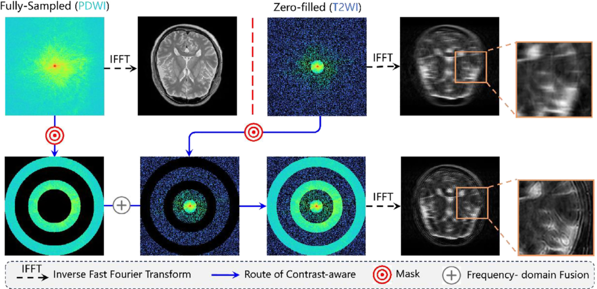
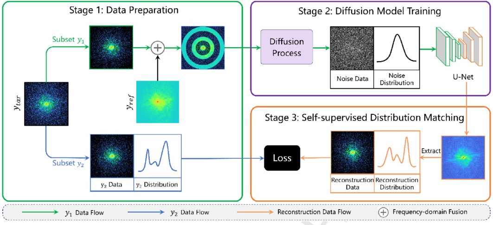
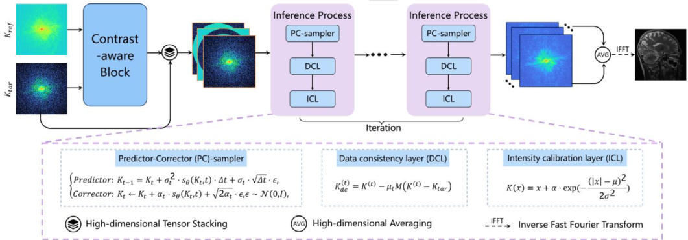
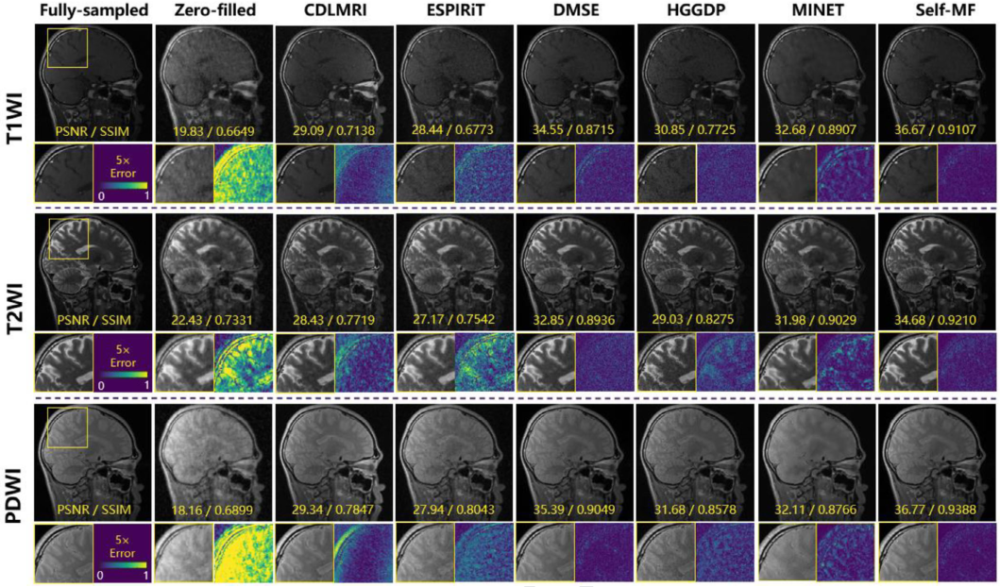

<div align="center">

<h1>Self-MF</h1>

<h3>Self-supervised Multi-contrast MRI Reconstruction<br>via Mask-guided Frequency-domain Fusion</h3>

<p><strong>Zhibo Chen</strong> · Dong Wang · Yu Guan · Xiang Ji · Qiegen Liu</p>

<p><strong><em>Medical Physics · 2026</em></strong></p>

<p>
  <code>Multi-contrast MRI</code> &nbsp;·&nbsp;
  <code>Self-supervised learning</code> &nbsp;·&nbsp;
  <code>Score-based diffusion</code>
</p>

<p>
  <a href="#overview"><strong>Overview</strong></a> &nbsp;·&nbsp;
  <a href="#method"><strong>Method</strong></a> &nbsp;·&nbsp;
  <a href="#experimental-results"><strong>Results</strong></a> &nbsp;·&nbsp;
  <a href="#implementation"><strong>Code</strong></a> &nbsp;·&nbsp;
  <a href="#citation"><strong>Citation</strong></a>
</p>

</div>

---

## Overview

**Self-MF** is a **self-supervised, score-based reconstruction framework** for accelerated **multi-contrast magnetic resonance imaging (MC-MRI)**. It exploits anatomical redundancy across image contrasts to recover an under-sampled target contrast **without requiring fully sampled target-contrast labels for training**.

The framework combines **mask-guided frequency-domain fusion**, **contrast-aware self-supervision**, and **conditional diffusion-based reconstruction**. A fully sampled auxiliary contrast provides structural guidance, while the acquired target k-space measurements supply target-specific information and data-fidelity constraints.

<table>
<tr>
<td width="33%" valign="top">
<strong>01 · Measurement-domain self-supervision</strong><br><br>
Learn from disjoint subsets of the acquired target k-space rather than relying on fully sampled target labels.
</td>
<td width="33%" valign="top">
<strong>02 · Cross-contrast frequency fusion</strong><br><br>
Construct complementary frequency-domain conditions that transfer anatomical guidance from an auxiliary contrast.
</td>
<td width="33%" valign="top">
<strong>03 · Physics-guided sampling</strong><br><br>
Combine score-based generation with k-space data consistency and intensity calibration.
</td>
</tr>
</table>

## Method

### 1. Mask-guided frequency-domain fusion

Self-MF transforms the fully sampled reference contrast into complementary, normalized frequency-domain components. These reference-derived structural channels are combined with the acquired target k-space and its sampling information to condition the score network. The auxiliary contrast guides structure recovery, while the target measurements determine target-specific contrast fidelity.

<div align="center">
  
  <p><sub><strong>Figure 1.</strong> Mask-guided frequency-domain fusion for reference-conditioned reconstruction.</sub></p>
</div>

### 2. Contrast-aware self-supervised learning

The acquired target k-space is randomly partitioned into an **input subset** and a disjoint **held-out supervision subset**. The input subset provides target-specific conditioning; the held-out subset supplies the self-supervised learning signal. The study examines different partition ratios and uses an input fraction of **0.4** in the main setting.

<div align="center">
  
  <p><sub><strong>Figure 2.</strong> Contrast-aware data preparation, diffusion learning, and self-supervised distribution matching.</sub></p>
</div>

### 3. Conditional diffusion-based reconstruction

At inference, a conditional score model reconstructs missing target information through iterative **predictor–corrector sampling**. A **data consistency layer (DCL)** enforces the acquired target k-space measurements, while an **intensity calibration layer (ICL)** mitigates intensity discrepancies introduced during cross-contrast guidance.

<div align="center">
  
  <p><sub><strong>Figure 3.</strong> Conditional score-based reconstruction with predictor–corrector sampling, DCL, and ICL.</sub></p>
</div>

## Experimental Results

Self-MF was evaluated on the **SIAT**, **IXI**, and **fastMRI brain** datasets using multiple MRI contrasts, sampling patterns, and acceleration factors. Selected quantitative results from the published article are summarized below.

| Dataset | Sampling pattern | Target contrast | PSNR ↑ (dB) | SSIM ↑ |
| :--- | :--- | :---: | ---: | ---: |
| SIAT | 2D random, R = 4 | T1WI | **35.16** | **0.8870** |
| SIAT | 2D random, R = 4 | T2WI | **33.46** | **0.9054** |
| SIAT | 2D random, R = 4 | PDWI | **35.31** | **0.9187** |
| fastMRI brain | 2D random, R = 4 | T2WI | **41.15** | **0.9637** |
| fastMRI brain | 2D random, R = 8 | T2WI | **35.02** | **0.8814** |

### Main reconstruction comparison

The following comparison presents representative reconstructions on the **SIAT multi-contrast MRI dataset** under **2D random undersampling at R = 4**. It includes T1WI, T2WI, and PDWI reconstructions from Self-MF and representative reference methods, together with enlarged regions and error maps.

<div align="center">
  
  <p><sub><strong>Figure 4.</strong> Main qualitative comparison of multi-contrast MRI reconstruction on SIAT (R = 4).</sub></p>
</div>

## Implementation

The repository includes the conditional score-model implementation, MRI processing operators, self-supervised training routines, reconstruction scripts, and experimental configurations.

```text
Self-MF/
├── README.md
├── selfmf/
│   ├── main.py                  Training / evaluation entry point
│   ├── reconstruct.py           Conditional reconstruction script
│   ├── sampling_conditional.py  Conditional diffusion sampling
│   ├── datasets_wd.py           SIAT data interface
│   ├── datasets_wd_IXI.py       IXI data interface
│   ├── mri_ops.py               MRI operators
│   ├── models/                  Score-network components
│   ├── configs/                 Experiment configurations
│   └── op/                      CUDA operators
├── figures/
│   ├── 1.png                    Frequency-domain fusion
│   ├── 2.png                    Self-supervised learning
│   ├── 3.png                    Reconstruction framework
│   └── 4.png                    Main reconstruction comparison
├── tests/
├── data/                       Data-format guidance
├── requirements.txt
├── CITATION.cff
└── THIRD_PARTY_NOTICES.md
```

### Environment and data

The implementation uses **PyTorch** with scientific Python dependencies and supporting CUDA operators. See [`requirements.txt`](requirements.txt) for dependencies and [`data/README.md`](data/README.md) for the required data layout and input fields.

Experiments require appropriately prepared multi-contrast MRI data, sampling masks, and configuration settings. The **SIAT clinical data and pretrained checkpoints are not distributed** in this repository. Public IXI and fastMRI datasets are subject to their respective access and usage terms.

### Training

From the `selfmf` directory, the configuration-based training interface is:

```bash
python main.py --config=configs/ve/SIAT_kdata_ncsnpp.py --workdir=exp --mode=train
```

### Reconstruction

The reconstruction script loads locally configured input data and model weights. Prepare the required inputs described in the data guide before invoking:

```bash
python reconstruct.py
```

## Citation

If you use Self-MF in your work, please cite:

```bibtex
@article{chen2026selfmf,
  title   = {Self-supervised multi-contrast MRI reconstruction via mask-guided frequency-domain fusion},
  author  = {Chen, Zhibo and Wang, Dong and Guan, Yu and Ji, Xiang and Liu, Qiegen},
  journal = {Medical Physics},
  year    = {2026},
  doi     = {10.1002/mp.70708}
}
```

## Acknowledgements

The score-based generative modeling components build on the **score_sde_pytorch** project. Third-party components retain their respective original license terms; see [`THIRD_PARTY_NOTICES.md`](THIRD_PARTY_NOTICES.md) and the accompanying license files.
